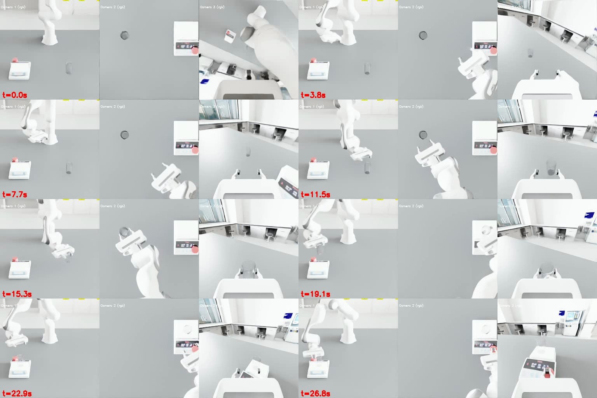
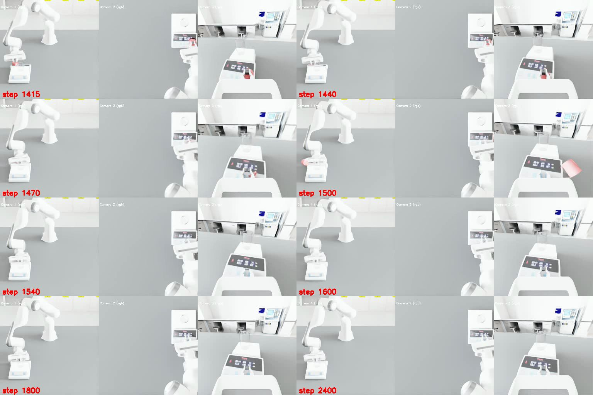
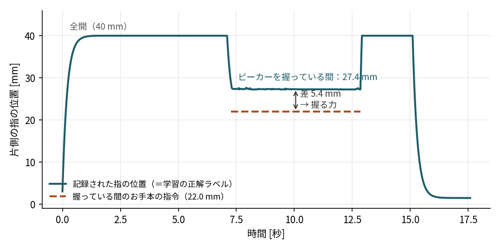

# 実験室でのロボットの動作の模倣学習を DGX Spark 上で再現する

Physical AI応用1講座の最終課題です。化学・生命科学の実験室を模したシミュレーター [LabUtopia](https://github.com/Rui-li023/LabUtopia)（NeurIPS 2025）で、ロボットアームの作業を模倣学習させました。デモの自動収集、学習、シミュレーター上の評価までを、すべて NVIDIA DGX Spark の1台で行っています。

- **AIの使い方**：LabUtopia に付属するお手本プログラム（シミュレーターから物体の正確な位置を受け取り、決めた手順どおりにロボットアームを動かす自動制御）でデモを集め、画像を入力とする方策（ACT）を学習しました。評価では、学習した方策がカメラ画像とロボットの状態を見てロボットを動かします。
- **目的**：公開されたベンチマークを、手元の Arm 系の AI ワークステーションで再現することです。論文は x86 系 CPU の PC と GPU（RTX 4090）で実験しています。

以下、「上流」は LabUtopia の公開リポジトリ（このリポジトリの `repo/`）を指します。

## 作業

| 作業 | コード名 | 内容 |
|---|---|---|
| ビーカーを台に置く | `level1_place`（Level 1） | ビーカーを目標の台まで運んで置く。ビーカーを掴むところまではお手本プログラムが行い、方策は運んで置く部分を担当する（上流の設計どおり） |
| ビーカーを加熱台に置いてボタンを押す | `level2_HeatLiquid`（Level 2。論文での名前は Heater Beaker） | ビーカーを掴み、加熱台に置き、ボタンを押す。3段階すべてを方策が担当する |

どちらも、エピソードごとにビーカーと目標の位置を15cm四方の範囲でランダムに変えます。デモの収集と評価で同じ範囲を使います（分布内の評価）。範囲の大きさは論文（4.2節）と同じで、具体的な座標は論文に記載がないため、上流の設定の値を使っています。

## 結果

学習した ACT の方策を、各作業50回ずつ動かしたときの成功回数です。2つの列の違いは、成功の判定方法だけです。

| 作業 | 論文の基準で判定<br>（2秒間保てば成功） | 公開コードで判定<br>（一瞬でも満たせば成功） | 論文の成功率<br>（ACT / DP） |
|---|---|---|---|
| ビーカーを台に置く | **50/50（100%）** | 50/50（100%） | 73.3% / 80.0% |
| ビーカーを加熱台に置いてボタンを押す（グリッパーの補正あり） | **46/50（92%）** | 49/50（98%） | 86.7% / 25.0% |
| ビーカーを加熱台に置いてボタンを押す（グリッパーの補正なし） | — | 0/3（3回で打ち切り） | — |

- 学習：デモは各100本。「ビーカーを台に置く」は60エポック（約3時間）、「ビーカーを加熱台に置いてボタンを押す」は51エポック（約9.5時間）。
- 補正なしの3回は、どれもビーカーを持ち上げては落とすことを繰り返して、上限の2500ステップに達しました。失敗が明らかだったので3回で打ち切りました。
- DP（Diffusion Policy）は、論文で比較対象になっている別の学習手法です。このリポジトリでは学習していません。



学習した方策による「ビーカーを加熱台に置いてボタンを押す」の実行例です（正面のカメラ）。掴む、運んで置く、ボタンを押すまでのすべてを、方策がカメラ画像を見て行っています。

### 成功の判定

上流のコードに入っている成功の判定は、論文に書かれている判定と違います。上流は条件を一瞬でも満たせば成功としますが、論文は目標の状態を2秒間保つことを求めています。一方で、論文には判定の考え方が文章で書かれているだけで、具体的な値（許容範囲の距離、倒れていないとみなす角度など）がありません。論文の数値を出した評価コードも公開されていません（開発中の `Dev` ブランチも確認しましたが、判定はどれも一瞬の判定でした）。そこで、公開コードの判定と、論文の文章のうち値が分かる条件だけで組み立てた判定（論文の基準）の両方で評価しました。

| | 公開コードの判定 | 論文の基準 |
|---|---|---|
| ビーカーを台に置く | ビーカーが目標の台から水平5cm以内・高さ5cm以内に入った瞬間に成功 | 左と同じ状態が2秒間（120ステップ）続けば成功 |
| ビーカーを加熱台に置いてボタンを押す | ビーカーが加熱台から水平5cm以内にあり、ボタンが押し込まれた状態に入った瞬間に成功 | 左と同じ状態が2秒間続き、かつ途中でビーカーを20cmより高く持ち上げていれば成功 |

- 2秒間（論文4.2節）と20cm（論文付録C.1.2）は、論文の値をそのまま使いました。
- 許容範囲の距離は論文に値がないので、上流の値を流用しました。
- 姿勢の条件（倒れていない、底面が接しているなど）は値がないので、推測で決めずに合否から外しました。そのため、論文の実際の判定より甘い可能性があります。
- どちらの判定でも、手を放すことは求めていません。「ビーカーを台に置く」は、ビーカーを握ったままでも成功になります。
- 実装は `patches/paper-success-eval.patch`、設定は `configs/eval_paper_*.yaml`（`infer.success_hold_steps: 120`、`infer.min_lift_m: 0.20`）です。

**論文の基準での内訳**

- 「ビーカーを台に置く」は、50回すべてでビーカーが許容範囲に2秒間とどまりました。
- 「ビーカーを加熱台に置いてボタンを押す」は、49回が許容範囲に入りました。このうち3回は、ボタンを押したあとにグリッパーがボタンの部品を引っかけて外してしまい、押された状態が約1.1〜1.4秒しか続きませんでした（下の図）。この3回は、公開コードの判定では成功に数えられていました。
- 残る1回は、ロボットアームがビーカーに近づかないまま上限の2500ステップに達しました。
- 20cmの条件は、許容範囲に入った49回すべてで満たしていました（持ち上げ高さは20.6〜24.4cm）。



`results/` にある、そのほかの画像は次のとおりです。

- `level2_HeatLiquid_demo.jpg`：お手本プログラムが集めたデモ
- `level1_place_policy_rollout.jpg`：「ビーカーを台に置く」の様子。約0〜7秒の「掴む」まではお手本プログラム、その後は方策が動かす
- `*_final_frames.jpg`：評価から無作為に選んだ8本の最終フレーム
- `level2_HeatLiquid_failure_episode.jpg`：公開コードの判定での唯一の失敗例
- `gripper_label_gap.png`：デモでの片側の指の位置と、お手本プログラムの指令値（次の節）
- `act_train_loss.png`：学習曲線

## 工夫した点：把持が滑る原因の特定と補正

「ビーカーを加熱台に置いてボタンを押す」で学習した方策は、最初の評価では3回とも失敗しました。ビーカーまで手を伸ばして挟むところまではできるのに、持ち上げると滑り落ちてしまうのです。原因は、デモの記録方式にありました。

- グリッパーの指は位置で制御されていて、目標の位置が物体の内側にあると、そこへ近づこうとして物体を押します。これが握る力になります。
- 指の値は、片側の指の位置（中心からの距離、単位m）です。お手本プログラムは、0.022（22.0mm）まで閉じる指令を出します。実際の指はビーカーに当たって約0.0274（27.4mm）で止まり（ビーカーの幅は約55mm）、この5.4mmの差が握る力を生んでいました。
- ところが LabUtopia は、行動として「次の時刻の関節角」、つまり指令値ではなく実際に到達した位置を記録します。学習した方策も記録どおり0.0274を指令するので、握る力が生まれず、ビーカーが滑り落ちます。



推論のときだけ、方策が「閉じる」側の値（0.035未満。全開は0.04）を出したら、0.006（お手本の差0.0054を丸めた値）だけ深く閉じるようにしました（`patches/infer-gripper-squeeze.patch`。評価の設定で `infer.gripper_squeeze` を指定したときだけ効きます）。学習はやり直していません。この補正で、成功率は0/3から、論文の基準で46/50、公開コードの判定で49/50になりました。

論文には、グリッパーの指令の扱いや握る力についての記述がなく、論文の実験でこの問題にどう対応したかは分かりません。

## DGX Spark（aarch64）で動かすための対応と、上流のコードへの修正

**aarch64 で動かすための対応**
- PyPIのPyTorchは、aarch64ではCPU版になります。そこで、uvの `override-dependencies` でCUDA 13版に差し替えました。Isaac Simが固定しているtorch 2.7は、GB10に対応していないためです。
- Isaac Simの拡張機能がtorchを読み込む時点で、`libc10.so: cannot allocate memory in static TLS block` が起きて異常終了していました。`GLIBC_TUNABLES=glibc.rtld.optional_static_tls=16384` と、libgompの事前読み込みで解消しました。
- 上流の `--headless` は、オプションを受け取るだけで使われておらず、常に画面を開こうとしていました。画面のないサーバーでも動くように直しました（`patches/headless-main.patch`）。

**上流のコードの不具合への対応**

上流のコードは、そのままでは学習も推論も動きませんでした。上流のファイルはなるべく書き換えず、上書きの設定と小さなスクリプトで対応しました。
- **学習の設定**：学習コードと設定ファイルで項目名（`checkpoint.topk`、カメラ名）が食い違っていたので、`configs/train/dgx_train_act.yaml` で上書きしました。
- **データの形式**：学習側は、エピソードを1つにまとめたHDF5しか読めないため、`scripts/make_dataset.py` を用意しました。
- **重みの形式**：学習で保存される重みと、推論側が読む形式が違うため、`scripts/export_policy.py` で変換します。テンソルだけを書き出すので、推論側はPyTorchの安全な読み込み（`weights_only`）のまま読めます。ただし変換の入力（学習の保存ファイル）は pickle 形式で、読み込むと中に仕込まれたコードが実行されうるため、**自分で学習したファイル以外は渡さないでください**。
- **推論時の切り替え**：推論モードで、掴み終えても方策に制御が移らず止まる不具合を直しました（`patches/place-infer-handover.patch`）。
- **成功判定**：`placepress` の成功判定は、代入のつもりが比較（`==`）になっていて、推論モードでは成功してもエピソードが終わらず、成功として数えられませんでした。これを直しました（`patches/placepress-infer-success.patch`）。

**デモ収集の高速化**
- Isaac Simを複数プロセスで同時に動かす `scripts/collect_parallel.sh` を作りました。
- 200本のデモを、約3.5時間で集めました。お手本プログラムの成功率は201回中200回で、成功した回だけを保存しています。

**安全性の確認**
- 実行前に、上流のコードとアセットを静的に検査しました（[docs/security-review.md](docs/security-review.md)）。

詳しい経緯、測定値、試したほかのタスク（Level 1〜5の8タスク）は [docs/dgx-spark-notes.md](docs/dgx-spark-notes.md) にあります。

## 環境

| 項目 | 構成 |
|---|---|
| 計算機 | NVIDIA DGX Spark（GB10 Grace Blackwell Superchip。CPU：Arm 20コア〔Cortex-X925 ×10、Cortex-A725 ×10〕、CPU と GPU で共有するメモリ 128GB、Ubuntu 24.04） |
| シミュレーター | Isaac Sim 5.1.0（`isaacsim[all,extscache]`、aarch64版） |
| Python | 3.11（uv管理） |
| PyTorch | 2.10.0+cu130（torchvision 0.25.0、torchaudio 2.10.0） |
| LabUtopia | `repo/`（サブモジュール）：コミット `8df7278`、MITライセンス |

## 再現手順

```bash
git clone --recursive https://github.com/seematsu/pai-final-assignment.git
cd pai-final-assignment
git -C repo lfs pull                 # シーンのアセット（約600MB）
bash scripts/uv.sh sync --frozen     # .venv を作る（約17GB）
bash scripts/apply_patches.sh        # 上流への最小限の修正
```

Isaac Simを動かすには、[NVIDIA Omniverse License Agreement](https://docs.omniverse.nvidia.com/dev-guide/latest/common/NVIDIA_Omniverse_License_Agreement.html) への同意が必要です。規約を読んで同意したら、同意の記録として `environment/eula-consent.json` を作ります。`scripts/run_main.sh` は、このファイルの `accepted` が `true` のときだけ起動します。

```bash
mkdir -p environment && echo '{"accepted": true}' > environment/eula-consent.json
```

デモの収集、学習、評価は次のとおりです。出力は `out/` に保存されます。

```bash
# 1. デモの収集（Isaac Simを並列に起動。液体の粒子があるシーンは --backend gpu）
bash scripts/collect_parallel.sh collect_level1_place 50 50
bash scripts/collect_parallel.sh collect_level2_HeatLiquid 34 33 33 -- --backend gpu

# 2. 学習用データにまとめる（HDF5の外部リンクで参照するのでコピーしない。別のマシンへ送るときは --copy）
.venv/bin/python scripts/make_dataset.py data/level1_place out/*_collect_level1_place_p*

# 3. 学習（ACT）
bash scripts/train.sh dgx_train_act data/level1_place act_level1_place \
  training.num_epochs=60 training.checkpoint_every=10 training.val_every=20

# 4. 推論用の重みを書き出し、configs/eval_*.yaml の重みの場所を合わせて評価
.venv/bin/python scripts/export_policy.py out/train/<run>/checkpoints/latest.ckpt out/train/<run>/checkpoints/policy_ema.ckpt
# 公開コードの判定
bash scripts/collect_parallel.sh eval_act_level1_place 25 25
bash scripts/collect_parallel.sh eval_act_level2_HeatLiquid 17 17 16 -- --backend gpu   # infer.gripper_squeeze を指定済み
# 論文の基準
bash scripts/collect_parallel.sh eval_paper_act_level1_place 25 25
bash scripts/collect_parallel.sh eval_paper_act_level2_HeatLiquid 17 17 16 -- --backend gpu
```

## 構成

```text
├── README.md
├── pyproject.toml, uv.lock, .python-version   # uv環境（Isaac Sim 5.1 + PyTorch cu130）
├── scripts/      # 起動・並列収集・データ化・学習・重みの書き出し・パッチ適用・動画の作成
├── configs/      # 収集（collect_*）・評価（eval_*）・動作確認（smoke_*）・学習（train/）・動画（video/）の設定
├── patches/      # 上流LabUtopiaへの修正
├── docs/         # 作業記録、セキュリティ確認
├── results/      # 評価の代表フレーム、学習曲線
└── repo/         # 上流LabUtopia（サブモジュール）
```

## ライセンスとクレジット

- **このリポジトリのコード**：MITライセンスです（[LICENSE](LICENSE)）。`configs/` と `patches/` には LabUtopia のコード（Copyright (c) 2025 辰、MITライセンス）由来の部分が含まれます。その著作権表示と許諾文は [LICENSE](LICENSE) に収めています。
- **LabUtopia のコード**：[LabUtopia](https://github.com/Rui-li023/LabUtopia)（Rui Li ほか、NeurIPS 2025）をサブモジュールとして参照しており、MITライセンスです。
- **シーンのアセット**：LabUtopia のシーンのアセット（3Dモデル・USD）は [CC BY-NC 4.0](https://creativecommons.org/licenses/by-nc/4.0/) で提供されています。このリポジトリには含めず、上流から取得します。
- **評価の画像と動画**：`results/` の画像と課題の動画は、このアセットを Isaac Sim で描画したシミュレーションの映像です（シーンそのものは改変していません）。非営利の教育目的（講座の課題）で使っています。アセットの出典は LabUtopia（Rui Li ほか）、ライセンスは CC BY-NC 4.0 です。
- **Isaac Sim**：再配布していません。利用者がそれぞれ、NVIDIA Omniverse License Agreement に同意する必要があります。
