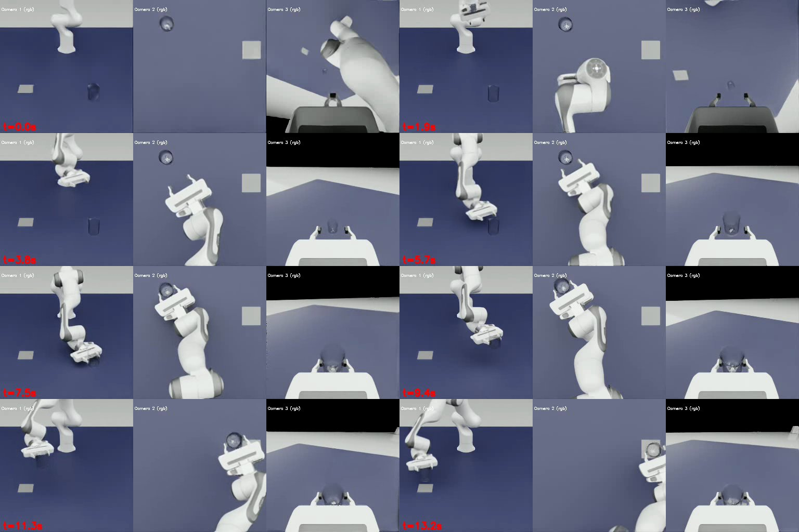

# 実験室ロボットの模倣学習をDGX Sparkで動かす（LabUtopia × ACT）

Physical AI応用1講座の最終課題です。化学・生命科学の実験室を模したシミュレーター [LabUtopia](https://github.com/Rui-li023/LabUtopia)（NeurIPS 2025）で、ロボットアームの作業を模倣学習させました。デモの自動収集、学習、シミュレーター上の評価までを、すべて NVIDIA DGX Spark（aarch64、GB10）の1台で行っています。

- **AIの使い方**：付属のお手本（ステートマシン）が集めたデモから、画像を入力とする方策（ACT）を学習しました。評価では、学習した方策がカメラ画像を見てロボットを動かします。
- **目的**：実験室の作業自動化に向けて、公開されたベンチマークを、手元のArm系のAIワークステーションで再現する手順を確立することです。論文はx86の環境（RTX 4090）を前提にしています。

## 結果

| タスク | 内容 | デモ | 学習 | 評価（成功率） | 論文（ACT / DP） |
|---|---|---|---|---|---|
| `level1_place` | 掴んだビーカーを目標の台へ運んで置く（掴む動作はお手本） | 100本 | ACT、60エポック、約3時間 | **50/50（100%）** | 73.3% / 80.0% |
| `level2_HeatLiquid` | ビーカーを掴む → 加熱台に置く → ボタンを押す（3段階すべてを方策が担当） | 100本 | ACT、51エポック（学習中） | 未評価 | 86.7% / 25.0% |



上の画像は、学習したACT方策による `level1_place` の1本目です。左から正面、真上、手首のカメラで、約0〜7秒の「掴む」まではお手本、その後は方策が動かしています。50本から無作為に選んだ8本の最終フレームは `results/level1_place_final_frames.jpg`、学習曲線は `results/level1_place_act_train_loss.png` にあります。

評価条件の注意：
- 物体の配置範囲は学習時と同じです（分布内の評価）。
- 成功の判定は上流のコードのままで、ビーカーが目標から水平5cm以内、高さが初期値から5cm以内に入った時点で成功とします。グリッパーを開いたかどうかは見ていません。

## 環境

| 項目 | 構成 |
|---|---|
| 計算機 | NVIDIA DGX Spark（GB10、sm_121、メモリ121GB、Ubuntu 24.04、aarch64） |
| シミュレーター | Isaac Sim 5.1.0（`isaacsim[all,extscache]`、aarch64版） |
| Python | 3.11（uv管理） |
| PyTorch | 2.10.0+cu130（torchvision 0.25.0、torchaudio 2.10.0） |
| LabUtopia | `repo/`（サブモジュール）：コミット `8df7278`、MITライセンス |

## 再現手順

```bash
git clone --recursive https://github.com/seematsu/pai-final-assignment.git
cd pai-final-assignment
git -C repo lfs pull                 # シーンのアセット（約600MB）
bash scripts/uv.sh sync --frozen     # .venv を作る（約17GB）
bash scripts/apply_patches.sh        # 上流への最小限の修正
```

Isaac Simを動かすには、[NVIDIA Omniverse License Agreement](https://docs.omniverse.nvidia.com/dev-guide/latest/common/NVIDIA_Omniverse_License_Agreement.html) への同意が必要です。規約を読んで同意したら、同意の記録として `environment/eula-consent.json` を作ります。`scripts/run_main.sh` は、このファイルの `accepted` が `true` のときだけ起動します。

```bash
mkdir -p environment && echo '{"accepted": true}' > environment/eula-consent.json
```

デモの収集、学習、評価は次のとおりです。出力は `out/` に保存されます。

```bash
# 1. デモの収集（Isaac Simを並列に起動。液体の粒子があるシーンは --backend gpu）
bash scripts/collect_parallel.sh collect_level1_place 50 50
bash scripts/collect_parallel.sh collect_level2_HeatLiquid 34 33 33 -- --backend gpu

# 2. 学習用データにまとめる（HDF5の外部リンクで参照するのでコピーしない。別のマシンへ送るときは --copy）
.venv/bin/python scripts/make_dataset.py data/level1_place out/*_collect_level1_place_p*

# 3. 学習（ACT）
bash scripts/train.sh dgx_train_act data/level1_place act_level1_place \
  training.num_epochs=60 training.checkpoint_every=10 training.val_every=20

# 4. 推論用の重みを書き出し、configs/eval_act_level1_place.yaml の重みの場所を合わせて評価
.venv/bin/python scripts/export_policy.py out/train/<run>/checkpoints/latest.ckpt out/train/<run>/checkpoints/policy_ema.ckpt
bash scripts/collect_parallel.sh eval_act_level1_place 25 25
```

## 工夫した点

**aarch64（DGX Spark）で動かすための対応**
- PyPIのPyTorchは、aarch64ではCPU版になります。そこで、uvの `override-dependencies` でCUDA 13版に差し替えました。Isaac Simが固定しているtorch 2.7は、GB10に対応していないためです。
- Isaac Simの拡張機能がtorchを読み込む時点で、`libc10.so: cannot allocate memory in static TLS block` が起きて異常終了していました。`GLIBC_TUNABLES=glibc.rtld.optional_static_tls=16384` と、libgompの事前読み込みで解消しました。
- 上流の `--headless` が実際には効いていなかったので、画面のないサーバーでも動くように直しました（`patches/headless-main.patch`）。

**上流のコードの不具合への対応**

上流のコードは、そのままでは学習も推論も動きませんでした。上流のファイルはなるべく書き換えず、上書きの設定と小さなスクリプトで対応しました。
- **学習の設定**：学習コードと設定ファイルで項目名（`checkpoint.topk`、カメラ名）が食い違っていたので、`configs/train/dgx_train_act.yaml` で上書きしました。
- **データの形式**：学習側は、エピソードを1つにまとめたHDF5しか読めないため、`scripts/make_dataset.py` を用意しました。
- **重みの形式**：学習で保存される重みと、推論側が読む形式が違うため、`scripts/export_policy.py` で変換します。テンソルだけを書き出すので、推論側はPyTorchの安全な読み込み（`weights_only`）のまま読めます。
- **推論時の切り替え**：推論モードで、掴み終えても方策に制御が移らず止まる不具合を直しました（`patches/place-infer-handover.patch`）。

**デモ収集の高速化**
- Isaac Simを複数プロセスで同時に動かす `scripts/collect_parallel.sh` を作りました。
- 200本のデモ（HeatLiquid 100本、place 100本）を、約3.5時間で集めました。お手本の成功率は、201回中200回です。

**安全性の確認**
- 実行前に、上流のコードとアセットを静的に検査しました（[docs/security-review.md](docs/security-review.md)）。

詳しい経緯、測定値、試したほかのタスク（Level 1〜5の8タスク）は [docs/dgx-spark-notes.md](docs/dgx-spark-notes.md) にあります。

## 構成

```text
├── README.md
├── pyproject.toml, uv.lock, .python-version   # uv環境（Isaac Sim 5.1 + PyTorch cu130）
├── scripts/      # 起動・並列収集・データ化・学習・重みの書き出し・パッチ適用
├── configs/      # 収集（collect_*）・評価（eval_*）・動作確認（smoke_*）・学習（train/）の設定
├── patches/      # 上流LabUtopiaへの修正
├── docs/         # 作業記録、セキュリティ確認
├── results/      # 評価の代表フレーム、学習曲線
└── repo/         # 上流LabUtopia（サブモジュール）
```

## ライセンスとクレジット

- **このリポジトリのコード**：MITライセンスです（[LICENSE](LICENSE)）。`configs/` と `patches/` には LabUtopia のコード（Copyright (c) 2025 辰、MITライセンス）由来の部分が含まれます。その著作権表示と許諾文は [LICENSE](LICENSE) に収めています。
- **LabUtopia のコード**：[LabUtopia](https://github.com/Rui-li023/LabUtopia)（Rui Li ほか、NeurIPS 2025）をサブモジュールとして参照しており、MITライセンスです。
- **シーンのアセット**：LabUtopia のシーンのアセット（3Dモデル・USD）は [CC BY-NC 4.0](https://creativecommons.org/licenses/by-nc/4.0/) で提供されています。このリポジトリには含めず、上流から取得します。
- **評価の画像と動画**：`results/` の画像と課題の動画は、このアセットを Isaac Sim で描画したシミュレーションの映像です（シーンそのものは改変していません）。非営利の教育目的（講座の課題）で使っています。アセットの出典は LabUtopia（Rui Li ほか）、ライセンスは CC BY-NC 4.0 です。
- **Isaac Sim**：再配布していません。利用者がそれぞれ、NVIDIA Omniverse License Agreement に同意する必要があります。
